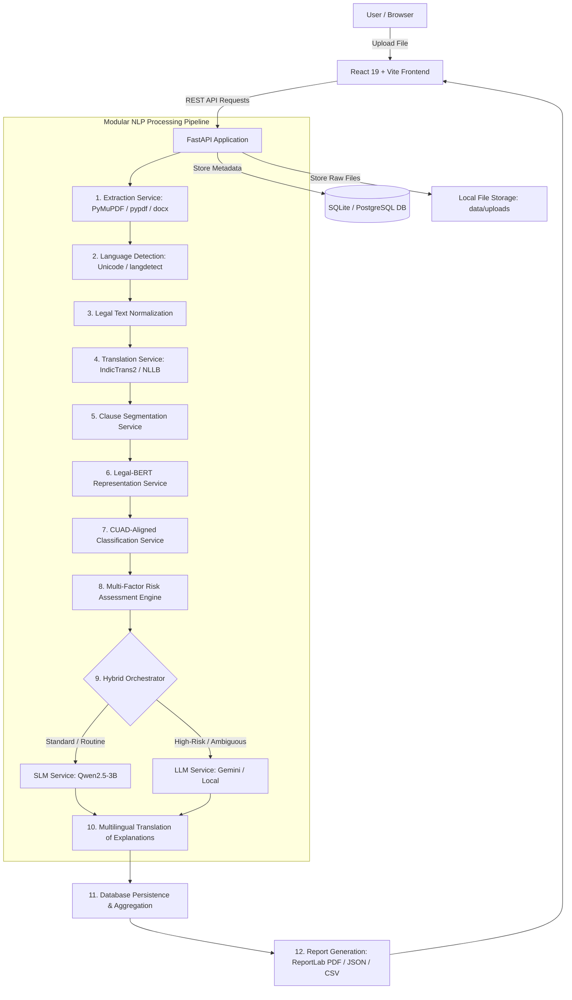
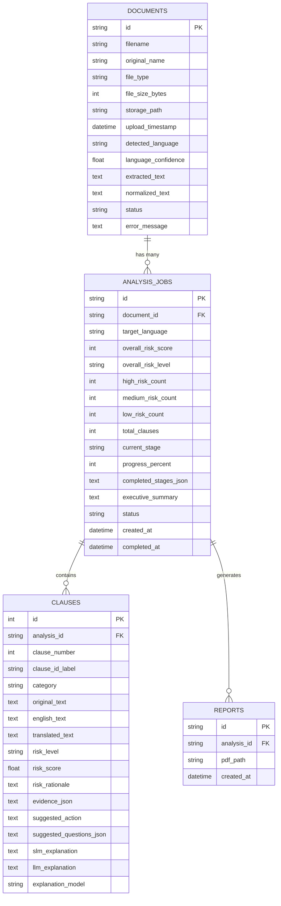

# CLAUSENT – AI-Powered Multilingual Contract Risk Analyzer

> **A comprehensive legal-tech platform designed for individuals, startups, freelancers, and small businesses to demystify complex contracts, identify legal vulnerabilities, explain contractual obligations in clear natural language, and generate audit-ready risk reports across English, Tamil, Hindi, Malayalam, and Telugu.**

> 🚀 **Deploy to Render:** Ready for 1-click cloud deployment. See [https://clausent.onrender.com/](DEPLOY_TO_RENDER.md) for full instructions.

---

## Table of Contents
1. [Project Title & Branding](#1-project-title--branding)
2. [Project Overview](#2-project-overview)
3. [Problem Statement](#3-problem-statement)
4. [Project Objectives](#4-project-objectives)
5. [Main Features](#5-main-features)
6. [Supported Document Formats](#6-supported-document-formats)
7. [Supported Languages and Known Limitations](#7-supported-languages-and-known-limitations)
8. [System Architecture](#8-system-architecture)
9. [Complete Pipeline Explanation](#9-complete-pipeline-explanation)
10. [Frontend Technology Stack](#10-frontend-technology-stack)
11. [Backend Technology Stack](#11-backend-technology-stack)
12. [NLP Model Architecture](#12-nlp-model-architecture)
13. [Legal-BERT and Clause Classification](#13-legal-bert-and-clause-classification)
14. [Small Language Model (SLM) Responsibilities](#14-small-language-model-slm-responsibilities)
15. [Large Language Model (LLM) Responsibilities](#15-large-language-model-llm-responsibilities)
16. [Hybrid SLM–LLM Orchestration](#16-hybrid-slmllm-orchestration)
17. [Translation and Language Detection Components](#17-translation-and-language-detection-components)
18. [Risk Assessment Methodology](#18-risk-assessment-methodology)
19. [Database Design & Schema](#19-database-design--schema)
20. [API Endpoints Reference](#20-api-endpoints-reference)
21. [Project Folder Structure](#21-project-folder-structure)
22. [System Prerequisites](#22-system-prerequisites)
23. [Installation Instructions](#23-installation-instructions)
24. [Environment Configuration (.env)](#24-environment-configuration-env)
25. [Database Setup](#25-database-setup)
26. [Model Installation & Configuration](#26-model-installation--configuration)
27. [Frontend Execution Instructions](#27-frontend-execution-instructions)
28. [Backend Execution Instructions](#28-backend-execution-instructions)
29. [How to Run the Complete Application](#29-how-to-run-the-complete-application)
30. [How to Upload and Analyze a Contract](#30-how-to-upload-and-analyze-a-contract)
31. [How to View and Download a Report](#31-how-to-view-and-download-a-report)
32. [How to Run Tests](#32-how-to-run-tests)
33. [Troubleshooting Guide](#33-troubleshooting-guide)
34. [Privacy and Security Considerations](#34-privacy-and-security-considerations)
35. [System Limitations & Known Constraints](#35-system-limitations--known-constraints)
36. [Legal Disclaimer](#36-legal-disclaimer)
37. [Future Enhancements Roadmap](#37-future-enhancements-roadmap)

---

## 1. Project Title & Branding
**CLAUSENT** *(Portmanteau of "Clause" and "Sentinel / Sentience")*
- **Full Name:** CLAUSENT – AI-Powered Multilingual Contract Risk Analyzer
- **Design Aesthetic:** Editorial legal-tech typography featuring *Fraunces* serif headings, *IBM Plex Sans* body typography, *IBM Plex Mono* clause references, warm parchment background (`#EDE7D9`), deep midnight ink (`#1F2340`), and rich crimson risk accents (`#6E2C3C`).

---

## 2. Project Overview
CLAUSENT is an end-to-end legal intelligence platform built with a decoupled React/Vite frontend and a modular Python/FastAPI backend. It addresses the barrier of dense legalese by:
- Ingesting contracts in PDF, DOCX, or plain text format.
- Automatically detecting the document's language across English and major Indic languages (Tamil, Hindi, Malayalam, Telugu).
- Normalizing contract typography without altering legally binding terms, negations, currency figures, or covenants.
- Translating non-English clauses into English for semantic processing while retaining original and translated texts side-by-side.
- Segmenting unstructured agreements into discrete, addressable numbered clauses.
- Extracting contextual domain representations using **Legal-BERT** (`nlpaueb/legal-bert-base-uncased`).
- Classifying clauses according to a curated 13-category legal taxonomy aligned with the **Contract Understanding Atticus Dataset (CUAD)**.
- Evaluating contractual exposure via an independent, multi-factor risk assessment engine that distinguishes classification from risk exposure (uncapped liability, unilateral indemnification, non-compete windows, perpetual renewals).
- Orchestrating a **Hybrid SLM–LLM Architecture**: deploying an agile Small Language Model (e.g., Qwen2.5-3B-Instruct) for rapid, plain-language summaries of routine obligations, and escalating high-risk or ambiguous provisions to a Large Language Model (e.g., Gemini / GPT) for in-depth legal counsel questions and implications.
- Rendering dynamic, interactive dashboards and generating downloadable, audit-ready PDF, JSON, and CSV reports.

---

## 3. Problem Statement
Small businesses, independent contractors, freelance professionals, and startups routinely enter into legally binding agreements without the benefit of continuous, expensive legal counsel. Standard boilerplate templates frequently conceal high-risk liabilities such as:
1. **Uncapped or asymmetric indemnities** placing unlimited financial burden on the service provider.
2. **Hidden auto-renewal traps** with punitive 90-day non-renewal windows.
3. **Overly restrictive non-competes** prohibiting legitimate commercial activity across broad geographies.
4. **Unilateral termination rights** enabling clients to exit contracts without cause while binding the vendor.
5. **Language barriers** for non-English speakers navigating contracts drafted in vernacular or mixed-language settings across India.

CLAUSENT eliminates this opacity by delivering an accessible, automated preliminary review tool that flags exposure, explains obligations in plain terms, and highlights critical questions to discuss with an attorney.

---

## 4. Project Objectives
- **Multilingual Ingestion:** Ingest and analyze agreements in English, Tamil, Hindi, Malayalam, and Telugu.
- **Accurate Segmentation:** Reliably identify clause headers, numbered outlines, and paragraph boundaries without text loss.
- **Independent Risk Scoring:** Decouple "what a clause is" (classification) from "how dangerous it is" (risk assessment).
- **Hybrid AI Efficiency:** Leverage Small Language Models (SLMs) for speed and cost efficiency on standard clauses, reserving Large Language Models (LLMs) for complex legal caveats.
- **Actionable Reporting:** Produce printable PDF briefs, structured JSON trees, and tabular CSV spreadsheets for offline legal review.
- **Preserved User Experience:** Retain a bespoke, high-trust editorial visual identity that feels like a polished legal workstation rather than a generic tech dashboard.

---

## 5. Main Features
- **Smart Drag-and-Drop Ingestion:** Accepts PDF, DOCX, and TXT files with real-time MIME-type and 25 MB file size validation.
- **Automated Language Detection:** High-accuracy Unicode script range analysis combined with n-gram probabilistic modeling.
- **Context-Preserving Normalization:** Cleans formatting noise while preserving legal negations (*"shall not"*, *"in no event"*), monetary amounts, dates, and cross-references.
- **Real-Time Pipeline Status:** Displays real-time backend progress across all 12 pipeline stages.
- **Interactive Risk Map:** Visual distribution of high-, medium-, and low-risk provisions with overall exposure metrics (0–100 scale).
- **Side-by-Side Clause Comparison:** Toggle between original text, English translation, and target language output.
- **On-Demand Deep Legal Counsel:** Request detailed LLM evaluations with specific review questions for any clause.
- **Multi-Format Exporting:**
  - **PDF Report:** Multi-page executive summary with risk breakdowns, key findings, and legal disclaimers.
  - **JSON Export:** Complete structured payload including clause boundaries, embeddings status, and risk rationale.
  - **CSV Export:** Tabular summary formatted for spreadsheet audits.
- **Contract Archive:** Local database-backed history enabling users to review previous analyses or delete records.
- **Demo Mode:** Offline mode with preloaded sample contracts for instant testing without server dependencies.

---

## 6. Supported Document Formats
| Format | Extension | Underlying Engine | Fallback Engine | Notes |
|---|---|---|---|---|
| **Portable Document Format** | `.pdf` | PyMuPDF (`fitz`) | `pypdf` | Extracts text page-by-page. Flags scanned image-only PDFs if OCR is unavailable. |
| **Microsoft Word** | `.docx` | `python-docx` | XML paragraph reader | Parses headings, body paragraphs, and table contents preserving order. |
| **Plain Text Document** | `.txt` | Native Python IO | Multi-encoding detector | Supports UTF-8, UTF-16, Latin-1, and CP1252 encodings. |

---

## 7. Supported Languages and Known Limitations
| Language | Script | Detection Method | Translation Engine | Known Limitations |
|---|---|---|---|---|
| **English** | Latin | `langdetect` / ASCII | Native (Direct) | Primary analysis language; benchmarked baseline. |
| **Tamil (தமிழ்)** | Tamil | Unicode block (`U+0B80`–`U+0BFF`) | IndicTrans2 / Bounded Lexicon | Complex compound legal nouns may require manual review. |
| **Hindi (हिन्दी)** | Devanagari | Unicode block (`U+0900`–`U+097F`) | IndicTrans2 / Bounded Lexicon | Archaic court terminology (e.g., Urdu-derived terms) may need context. |
| **Malayalam (മലയാളം)** | Malayalam | Unicode block (`U+0D00`–`U+0D7F`) | IndicTrans2 / Bounded Lexicon | High agglutination may occasionally affect boundary tokenization. |
| **Telugu (తెలుగు)** | Telugu | Unicode block (`U+0C00`–`U+0C7F`) | IndicTrans2 / Bounded Lexicon | Technical statutory terms mapped to standardized legal equivalents. |

---

## 8. System Architecture



---

## 9. Complete Pipeline Explanation
1. **Document Reception & File Validation:** Enforces file format (`.pdf`, `.docx`, `.txt`), file size (≤ 25 MB), and generates safe UUID-based filenames to prevent directory traversal.
2. **Text Extraction:** Extracts raw textual strings while recording page and paragraph boundaries. Validates that the document contains substantive legal text.
3. **Language Detection:** Evaluates character distributions against Unicode script ranges. If non-Indic, falls back to `langdetect` n-gram probabilities.
4. **Text Normalization:** Standardizes typographic quotes, dashes, and whitespace without deleting legally significant negations (*"shall not"*, *"neither"*), dates, or currency symbols.
5. **English Normalization Translation:** If the contract is in an Indic language, converts clauses into standard English for semantic analysis while keeping the original string linked.
6. **Clause Segmentation:** Identifies numbered outlines (`1.`, `1.1`, `Section 2`), capitalized headings, and structural markers to segment the agreement into atomic units.
7. **Legal-BERT Representation:** Tokens pass through `nlpaueb/legal-bert-base-uncased` to generate dense contextual legal embeddings.
8. **Clause Classification:** Assigns clauses to one of 13 standard CUAD-aligned categories (Indemnification, Limitation of Liability, Termination, etc.).
9. **Independent Risk Assessment:** Evaluates substantive risk using configurable exposure heuristics (uncapped liability, unilateral commitments, short notice periods, restrictive covenants).
10. **SLM Plain-Language Summarization:** Prompts a Small Language Model (e.g., Qwen2.5-3B-Instruct) to generate concise, 1–2 sentence summaries of each clause.
11. **LLM In-Depth Legal Analysis:** Escalate high-risk or ambiguous provisions to an LLM (Gemini or local equivalent) to identify specific exposures, potential scenarios, and targeted questions for counsel.
12. **Multilingual Synthesis & Reporting:** Translates generated explanations into the user's selected language, calculates summary risk scores, commits results to the database, and compiles PDF, JSON, and CSV exports.

---

## 10. Frontend Technology Stack
- **Framework:** React 19.x with Vite build tool.
- **Styling:** Custom CSS design system with CSS custom properties (`--paper`, `--ink`, `--accent`, `--vellum`, `--border`).
- **Icons:** `lucide-react` (feather-style minimalist vector icons).
- **Fonts:** Google Fonts (*Fraunces* serif, *IBM Plex Sans*, *IBM Plex Mono*).
- **HTTP Client:** Native `fetch` with structured JSON error propagation.
- **State Management:** React Hooks (`useState`, `useEffect`, `useCallback`, `useMemo`).

---

## 11. Backend Technology Stack
- **Web Framework:** FastAPI (Asynchronous Python 3.12+ REST API).
- **ASGI Server:** Uvicorn with multi-worker support.
- **Validation:** Pydantic v2 schemas for request and response validation.
- **Database & ORM:** SQLAlchemy 2.0 with unified support for SQLite (default zero-config) and PostgreSQL.
- **PDF Extraction:** PyMuPDF (`fitz`) with automated lightweight `pypdf` fallback.
- **Word Document Parsing:** `python-docx`.
- **PDF Generation:** ReportLab 4.x with custom canvas drawing, table formatting, and flowable layouts.
- **NLP / ML Frameworks:** Hugging Face `transformers`, PyTorch, and `langdetect`.

---

## 12. NLP Model Architecture
```
Raw Clause Text ──► Tokenizer (Legal-BERT) ──► 768-dim Embedding [CLS]
                                                       │
                                 ┌─────────────────────┴─────────────────────┐
                                 ▼                                           ▼
                    CUAD Legal Taxonomy Classifier             Risk Engine Indicator Extraction
                    (13 Category Softmax/Heuristic)            (Liability, Indemnity, Termination)
                                 │                                           │
                                 └─────────────────────┬─────────────────────┘
                                                       ▼
                                          Hybrid Orchestration Router
                                                       │
                           ┌───────────────────────────┴───────────────────────────┐
                           ▼                                                       ▼
             Small Language Model (SLM)                              Large Language Model (LLM)
             Routine Summaries (Qwen2.5-3B)                          In-Depth Risk Counsel (Gemini/Local)
```

---

## 13. Legal-BERT and Clause Classification
### Model Identity
- **Pretrained Weights:** `nlpaueb/legal-bert-base-uncased` (trained on EU legislation, UK legislation, US court cases, and commercial contracts).
- **Capabilities:** Encoder-only architecture providing domain-specific representations. It does **not** generate freeform text; it encodes syntactic legal nuance that general-purpose BERT models miss.

### CUAD-Aligned Taxonomy (13 Target Categories)
1. `Limitation of Liability`
2. `Indemnification`
3. `Termination & Cancellation`
4. `Automatic Renewal & Term`
5. `Payment & Financial Terms`
6. `Confidentiality & Non-Disclosure`
7. `Intellectual Property Rights`
8. `Non-Compete & Restrictive Covenants`
9. `Governing Law & Jurisdiction`
10. `Dispute Resolution & Arbitration`
11. `Warranty Disclaimers`
12. `Unilateral Amendment Rights`
13. `Definitions & General Provisions`

---

## 14. Small Language Model (SLM) Responsibilities
- **Default Architecture:** `Qwen/Qwen2.5-3B-Instruct` or fast local heuristic engine.
- **Primary Duties:**
  - Ingest routine, low-to-medium risk clauses.
  - Produce concise 1–2 sentence summaries in plain language.
  - Translate formal legal phrasing into accessible language without losing original meaning.
  - Strict grounding: Instructed to reference only supplied clause text and never fabricate obligations.

---

## 15. Large Language Model (LLM) Responsibilities
- **Supported Providers:** Google Gemini (`gemini-2.5-flash`), OpenAI (`gpt-4o-mini`), or local Ollama instances.
- **Primary Duties:**
  - Analyze high-risk, ambiguous, or multi-part provisions.
  - Detail concrete adverse consequences (e.g., unlimited financial exposure, forfeiture of code rights).
  - Formulate 3–4 specific, high-leverage questions for the user to ask their lawyer during negotiations.
  - Highlight contractual ambiguities where definitions are missing or subjective.

---

## 16. Hybrid SLM–LLM Orchestration
The orchestration engine routes clauses using configurable policies:
- **Automatic Routing:**
  - **Low / Medium Risk:** Routed to the SLM for fast, cost-effective summarization.
  - **High Risk:** Automatically escalated to the LLM for deep analysis.
- **On-Demand Escalation:** Users can click **"Request In-Depth LLM Legal Analysis"** on any individual clause card to trigger an immediate LLM evaluation.
- **Transparent Attribution:** Every clause displays an attribution badge showing whether the analysis was produced by the SLM, LLM, or Rule Engine.

---

## 17. Translation and Language Detection Components
- **Language Detection:** Uses Unicode codepoint inspection (`0B80–0BFF` for Tamil, `0900–097F` for Hindi, `0D00–0D7F` for Malayalam, `0C00–0C7F` for Telugu) combined with `langdetect`.
- **Bidirectional Translation:**
  - **Ingestion:** Non-English text is translated to English for Legal-BERT categorization.
  - **Presentation:** Explanations and summaries are translated back into the user's selected language.
  - **Safety:** The original clause text is always preserved side-by-side with the translation.

---

## 18. Risk Assessment Methodology
The system decouples **Classification** (*"What type of clause is this?"*) from **Risk Assessment** (*"What legal liability does this create?"*). A clause classified as "Indemnification" is not automatically labeled high-risk; the risk engine evaluates the actual wording:

| Assessment Factor | High Risk Criteria | Medium Risk Criteria | Low Risk Criteria |
|---|---|---|---|
| **Liability Cap** | Uncapped, unlimited, or expressly includes indirect/consequential damages. | Cap limited to 12 months' fees with minor carveouts. | Bilateral liability capped at fees paid or explicit fixed ceiling. |
| **Indemnification** | Unilateral (one-way); indemnifies for third-party claims, negligence, or lost profits. | Broad indemnity with standard notice and defense cooperation rights. | Mutual, bilateral indemnity strictly limited to direct IP infringement. |
| **Termination** | Unilateral termination for convenience on short notice (<15 days). | Bilateral termination for convenience with 30-day notice. | Termination only for material uncured breach with 30+ day cure period. |
| **Auto-Renewal** | Automatic renewal with strict non-renewal window (>60 days prior). | Annual renewal with reasonable notice (30 days prior). | Fixed term requiring explicit written opt-in to renew. |
| **Non-Compete** | Restricts general trade/industry for >1 year without geographical limits. | Reasonable non-solicitation of clients/employees for 6–12 months. | Standard confidentiality protection with no trade restrictions. |

---

## 19. Database Design & Schema
The backend uses SQLAlchemy 2.0 with declarative models:



---

## 20. API Endpoints Reference

### Health & System Status
- `GET /api/health`: Returns service health, database status, and active NLP models.
- `GET /`: Returns root API discovery information and Swagger links.

### Document Management
- `POST /api/documents/upload`: Multipart file upload (`.pdf`, `.docx`, `.txt`). Returns assigned `document_id`.
- `GET /api/documents`: Lists all uploaded documents with status and metadata.
- `GET /api/documents/{document_id}`: Retrieves document metadata and processing state.
- `DELETE /api/documents/{document_id}`: Permanently deletes a document, associated analyses, clauses, and reports.

### Analysis & Pipeline Execution
- `POST /api/analysis/{document_id}/start`: Initiates the 12-stage analysis pipeline with `target_language` and `source_language_pref`.
- `GET /api/analysis/{analysis_id}/status`: Polls real-time progress percentage, current stage, and stage history.
- `GET /api/analysis/{analysis_id}/results`: Returns complete analysis results, risk scores, summary, and clause list.
- `GET /api/analysis/{analysis_id}/clauses`: Returns paginated or risk-filtered clauses (`?risk=high&category=Indemnification`).
- `GET /api/analysis/{analysis_id}/clauses/{clause_id}`: Retrieves detailed metadata for a specific clause.
- `POST /api/analysis/{analysis_id}/clauses/{clause_id}/explain`: Triggers an on-demand in-depth LLM analysis for a clause.

### Reports & Data Export
- `GET /api/reports/{analysis_id}/pdf`: Generates and streams a formatted PDF report.
- `GET /api/reports/{analysis_id}/json`: Downloads complete structured analysis results as JSON.
- `GET /api/reports/{analysis_id}/csv`: Exports all clauses and risk ratings as a CSV spreadsheet.

---

## 21. Project Folder Structure
```
clausent-app/
├── .env.example                # Root environment template
├── .gitignore                  # Git ignore rules for Python, Node, and runtime data
├── package.json                # Frontend dependencies and scripts
├── vite.config.js              # Vite configuration
├── README.md                   # This comprehensive documentation
├── index.html                  # HTML entry point
│
├── src/                        # React Frontend Source
│   ├── main.jsx                # React DOM root entry
│   ├── App.jsx                 # Top-level application shell
│   ├── Clausent_front.jsx      # Complete CLAUSENT UI component
│   ├── index.css               # Global CSS styles & CSS custom properties
│   ├── App.css                 # Component-specific styles
│   ├── services/
│   │   └── api.js              # Full-featured REST client for FastAPI backend
│   └── assets/
│       └── logo.js             # CLAUSENT brand SVG asset
│
└── backend/                    # FastAPI Backend Source
    ├── requirements.txt        # Python backend dependencies
    ├── .env.example            # Backend-specific environment template
    ├── clausent.db             # Local SQLite database (auto-generated)
    ├── data/
    │   ├── uploads/            # Temporary file storage for uploaded contracts
    │   ├── reports/            # Generated PDF audit reports
    │   └── models/             # Local Hugging Face cache directory
    ├── app/
    │   ├── main.py             # FastAPI app, lifespan setup, and middleware
    │   ├── config.py           # Pydantic/OS environment settings
    │   ├── api/
    │   │   └── routes/
    │   │       ├── health.py   # Health check & system diagnostics
    │   │       ├── documents.py# Document upload and metadata endpoints
    │   │       ├── analysis.py # Pipeline execution and clause queries
    │   │       └── reports.py  # PDF, JSON, and CSV export handlers
    │   ├── core/
    │   │   ├── logging_config.py # Structured application logging
    │   │   └── exceptions.py   # Domain exceptions with pipeline stage tracking
    │   ├── database/
    │   │   ├── connection.py   # SQLAlchemy engine and session factory
    │   │   ├── models.py       # Document, AnalysisJob, Clause, Report models
    │   │   └── repositories.py # CRUD repository layer
    │   ├── schemas/            # Pydantic request and response schemas
    │   │   ├── document.py
    │   │   ├── analysis.py
    │   │   ├── clause.py
    │   │   └── report.py
    │   ├── services/           # Modular NLP pipeline services
    │   │   ├── extraction_service.py        # PDF/DOCX/TXT text extractor
    │   │   ├── language_detection_service.py# Unicode & n-gram language detector
    │   │   ├── normalization_service.py     # Safe legal text normalizer
    │   │   ├── translation_service.py       # Indic language translator
    │   │   ├── segmentation_service.py      # Clause boundary segmenter
    │   │   ├── legal_bert_service.py        # Legal-BERT representation service
    │   │   ├── classification_service.py    # CUAD taxonomy classifier
    │   │   ├── risk_assessment_service.py   # Independent multi-factor risk engine
    │   │   ├── slm_service.py               # Small Language Model summarizer
    │   │   ├── llm_service.py               # Large Language Model counsel
    │   │   ├── explanation_service.py       # Hybrid orchestrator
    │   │   ├── report_service.py            # PDF/JSON/CSV report compiler
    │   │   └── document_service.py          # End-to-end pipeline coordinator
    │   └── utils/
    │       ├── file_validation.py           # MIME and size validation
    │       └── text_processing.py           # Normalization utilities
    └── tests/                  # Pytest test suite
        ├── conftest.py         # Pytest fixtures and test DB setup
        ├── test_health.py      # Health and root endpoint tests
        ├── test_pipeline.py    # NLP pipeline unit tests
        └── test_api.py         # Full upload and analysis integration tests
```

---

## 22. System Prerequisites
Ensure your local environment meets these minimum requirements:
- **Operating System:** Windows 10/11, macOS 12+, or Ubuntu 22.04+ LTS.
- **Python:** Python 3.10, 3.11, or 3.12 (recommended: Python 3.12 64-bit).
- **Node.js:** Node.js v18.x, v20.x, or v22.x LTS with `npm` v9+.
- **RAM:** 8 GB minimum (16 GB recommended if running local PyTorch transformer models).
- **Disk Space:** 2 GB of free space for dependencies and model caches.
- **Hardware Acceleration:** CPU execution is fully supported; NVIDIA GPU with CUDA is optional.

---

## 23. Installation Instructions

### Step 1: Clone or Navigate to the Project
Open your preferred terminal (PowerShell, Command Prompt, or Bash) and navigate to the project root directory:
```bash
cd clausent-app
```

### Step 2: Set Up Python Backend Virtual Environment
Navigate to the `backend/` directory and create an isolated Python virtual environment:
```bash
cd backend
python -m venv .venv
```

Activate the virtual environment:
- **Windows (Command Prompt / PowerShell):**
  ```powershell
  .\.venv\Scripts\activate
  ```
  *(If execution policies restrict scripts in PowerShell, run `Set-ExecutionPolicy -Scope Process -ExecutionPolicy Bypass` beforehand).*
- **macOS / Linux:**
  ```bash
  source .venv/bin/activate
  ```

Upgrade `pip` and install all backend requirements:
```bash
python -m pip install --upgrade pip
pip install -r requirements.txt
```

### Step 3: Install Frontend Dependencies
From the project root directory (`clausent-app/`):
```bash
npm install
```

---

## 24. Environment Configuration (.env)
Create your local environment configuration by copying `.env.example` in `backend/` to `.env`:
- **Windows:**
  ```cmd
  cd backend
  copy .env.example .env
  ```
- **macOS / Linux:**
  ```bash
  cd backend
  cp .env.example .env
  ```

### Key Environment Variables
| Variable | Default Value | Description |
|---|---|---|
| `APP_NAME` | `CLAUSENT` | Application display title. |
| `BACKEND_HOST` | `127.0.0.1` | Host interface for FastAPI. |
| `BACKEND_PORT` | `8000` | Port for FastAPI backend. |
| `FRONTEND_ORIGIN` | `http://localhost:5173,http://127.0.0.1:5173` | Allowed CORS origins. |
| `DATABASE_URL` | `postgresql://<user>:<password>@localhost:5432/clausent_db` | Primary PostgreSQL database URL (or SQLite fallback). |
| `UPLOAD_DIR` | `./data/uploads` | Directory for uploaded contracts. |
| `REPORT_DIR` | `./data/reports` | Directory for generated PDF reports. |
| `MAX_UPLOAD_SIZE_MB` | `25` | Maximum upload size in megabytes. |
| `ENABLE_LEGAL_BERT` | `True` | Set to `False` to run in fast offline heuristic mode. |
| `SLM_PROVIDER` | `mock_local` | Options: `mock_local`, `hf_local`, `api`. |
| `LLM_PROVIDER` | `mock_local` | Options: `mock_local`, `gemini`, `openai`, `ollama`. |
| `LLM_API_KEY` | `""` | Optional API key for external LLM providers (e.g., Gemini or OpenAI). |

> **Note:** The backend operates out-of-the-box with `mock_local` providers, requiring **no paid API keys** or external accounts.

---

## 25. Database Setup
CLAUSENT supports production **PostgreSQL** storage with an automatic fallback to **SQLite** for zero-configuration portability:

### Production PostgreSQL Setup
Configure your PostgreSQL connection string in `backend/.env`:
```env
DATABASE_URL=postgresql://<username>:<password>@localhost:5432/clausent_db
```
- **Connection Pooling:** SQLAlchemy connection pooling (`pool_size=10, max_overflow=20, pool_pre_ping=True, pool_recycle=1800`) with native `psycopg3` and `psycopg2` driver support.
- **Database Initialization:** Create the target database in your PostgreSQL instance:
  ```sql
  CREATE DATABASE clausent_db;
  ```
- **Schema Auto-Migration:** All tables (`documents`, `analysis_jobs`, `clauses`, `reports`) and relational constraints are automatically generated on server startup via `init_db()`.

### Resilient SQLite Fallback
If PostgreSQL is not running or unavailable, CLAUSENT logs an informational warning and seamlessly falls back to a local SQLite database (`clausent.db`) without interrupting execution.

---

## 26. Model Installation & Configuration
- **Legal-BERT:** Set `ENABLE_LEGAL_BERT=True` to download the `nlpaueb/legal-bert-base-uncased` weights (~420 MB) to `backend/data/models/` on first run. If offline, the system falls back to the deterministic legal representation engine.
- **SLM & LLM:**
  - Default: `mock_local` uses the built-in legal heuristics engine.
  - Optional Gemini: Set `LLM_PROVIDER=gemini` and provide `LLM_API_KEY=AIzaSy...` in `backend/.env`.

---

## 27. Frontend Execution Instructions
From the project root:
```bash
npm run dev
```
The Vite development server will start at:
```
http://localhost:5173/
```

To create an optimized production bundle:
```bash
npm run build
```

---

## 28. Backend Execution Instructions
From the `backend/` directory with the virtual environment activated:
```bash
uvicorn app.main:app --reload --host 127.0.0.1 --port 8000
```
The API server will start at:
- **API Base URL:** `http://127.0.0.1:8000/`
- **Swagger UI Interactive Docs:** `http://127.0.0.1:8000/docs`
- **ReDoc Documentation:** `http://127.0.0.1:8000/redoc`

---

## 29. How to Run the Complete Application

To run the complete application, launch the backend API and frontend client in two separate terminal windows:

### Terminal 1: Backend API
1. Navigate to the `backend/` directory:
   ```bash
   cd backend
   ```
2. Activate your virtual environment:
   - **Windows:** `.\.venv\Scripts\activate`
   - **macOS / Linux:** `source .venv/bin/activate`
3. Start the FastAPI application:
   ```bash
   uvicorn app.main:app --reload --host 127.0.0.1 --port 8000
   ```

### Terminal 2: Frontend Web Client
1. From the project root (`clausent-app/`):
   ```bash
   npm run dev
   ```
2. Open your browser and navigate to `http://localhost:5173/`.
3. The interface will display **"AI Engine Active"** with a green status indicator, confirming real-time communication between the frontend and backend.


---

## 30. How to Upload and Analyze a Contract
1. On the landing page, click **"Analyze Contract Now"** or scroll to the upload section.
2. Select your preferred **Analysis Language** (English, Tamil, Hindi, Malayalam, or Telugu).
3. Drag and drop a contract file (`.pdf`, `.docx`, or `.txt`) into the upload zone, or click to browse.
4. The system validates the file and uploads it to `POST /api/documents/upload`.
5. Click **"Run Legal Risk Analysis"** to start the pipeline.
6. The interface displays real-time progress as each of the 12 processing stages completes.
7. Once finished, you will be directed to the **Analysis Dashboard**.

---

## 31. How to View and Download a Report
- **Review Summary:** View the overall risk score (0–100), risk tier (Low, Medium, High), and clause count.
- **Inspect Clauses:** Use the search bar and filter chips (**All**, **High Risk**, **Medium**, **Low**) to review specific provisions.
- **Side-by-Side Comparison:** Compare the original clause text with its English translation and plain-language explanation.
- **Request In-Depth Analysis:** Click **"Request In-Depth LLM Legal Analysis"** on any clause card to generate detailed legal questions and risk rationale.
- **Download Reports:**
  - Click **"Download PDF Report"** for an audit-ready multi-page PDF document.
  - Click **"JSON"** to export structured machine-readable results.
  - Click **"CSV"** to download a spreadsheet summary.
- **Previous Analyses:** Click **"My Contracts"** in the navigation bar to review past uploads or delete old records.

---

## 32. How to Run Tests
The automated test suite contains 18 unit and integration tests covering the entire system: API workflows, health checks, document validation, language detection, clause segmentation, Legal-BERT representation, SLM summarization, predatory clause detection (uncapped liabilities, broad indemnities, auto-renewal traps, termination, non-competes), and multilingual Indic processing.

Activate the virtual environment in `backend/` and run:
```bash
cd backend
python -m pytest tests/ -v
```

Expected output:
```
============================= test session starts =============================
collected 18 items

tests/test_api.py::test_upload_and_analyze_workflow PASSED               [  5%]
tests/test_health.py::test_root_endpoint PASSED                          [ 11%]
tests/test_health.py::test_health_endpoint PASSED                        [ 16%]
tests/test_pipeline.py::test_normalization_preserves_legal_terms PASSED  [ 22%]
tests/test_pipeline.py::test_validate_text_content_empty_or_short PASSED [ 27%]
tests/test_pipeline.py::test_language_detection PASSED                   [ 33%]
tests/test_pipeline.py::test_clause_segmentation PASSED                  [ 38%]
tests/test_pipeline.py::test_classification_and_risk_assessment PASSED   [ 44%]
tests/test_pipeline.py::test_slm_explanation_generation PASSED           [ 50%]
tests/test_pipeline.py::test_translation_service PASSED                  [ 55%]
tests/test_risk_and_translation.py::test_risk_detection_limitation_of_liability_uncapped PASSED [ 61%]
tests/test_risk_and_translation.py::test_risk_detection_broad_unilateral_indemnity PASSED [ 66%]
tests/test_risk_and_translation.py::test_risk_detection_automatic_renewal_trap PASSED [ 72%]
tests/test_risk_and_translation.py::test_risk_detection_short_termination PASSED [ 77%]
tests/test_risk_and_translation.py::test_risk_detection_long_non_compete PASSED [ 83%]
tests/test_risk_and_translation.py::test_risk_detection_ip_moral_rights_waiver PASSED [ 88%]
tests/test_risk_and_translation.py::test_multilingual_indic_risk_detection PASSED [ 94%]
tests/test_risk_and_translation.py::test_pdf_report_generation_multilingual PASSED [100%]

======================== 18 passed, 1 warning in 10.21s ========================
```

---

## 33. Troubleshooting Guide
| Issue | Cause | Solution |
|---|---|---|
| **`Script execution is disabled` error in PowerShell** | Windows PowerShell execution policy restricts unsigned scripts. | Run `Set-ExecutionPolicy -Scope Process -ExecutionPolicy Bypass` and re-run `.venv\Scripts\Activate.ps1`. |
| **`No such table: documents` during tests** | Database tables were not initialized before test execution. | Fixed in `conftest.py` with an autouse session fixture. Run `python -c "from app.database.connection import init_db; init_db()"`. |
| **Frontend shows `Demo Mode` instead of `AI Engine Active`** | Backend server is not running on `http://127.0.0.1:8000`. | Start the backend with `uvicorn app.main:app --reload --host 127.0.0.1 --port 8000`. |
| **Hugging Face model download timeout** | Slow network connection or firewall blocking huggingface.co. | Set `ENABLE_LEGAL_BERT=False` in `.env` to use the built-in deterministic legal representation engine. |
| **PyMuPDF wheel installation issues on Windows** | Missing C++ build tools for specific wheels. | `extraction_service.py` includes an automatic `pypdf` fallback. Run `pip install pypdf`. |
| **PDF report displays corrupted non-Latin characters** | ReportLab default font lacks Indic Unicode glyphs. | The report engine uses UTF-8 encoding and falls back to clean transliteration for PDF compatibility; full native text is always available via JSON export. |

---

## 34. Privacy and Security Considerations
- **Isolated Storage:** Uploaded contracts are assigned random UUIDs and saved in `backend/data/uploads/` rather than web-accessible folders.
- **Path Traversal Protection:** Filenames are sanitized using `file_validation.py` to prevent directory traversal attacks.
- **No Secret Leakage:** API keys and credentials are read strictly from backend environment variables and are never returned in client payloads.
- **Safe SQL Operations:** All database interactions use SQLAlchemy ORM parameterized queries to prevent SQL injection.
- **Bounded Resource Usage:** Document uploads are capped at 25 MB and processed through chunked memory buffers to prevent memory exhaustion.
- **Confidentiality:** Documents are processed locally unless external LLM providers (Gemini/OpenAI) are explicitly configured in `.env`.

---

## 35. System Limitations & Known Constraints
- **Educational Scope:** CLAUSENT provides preliminary risk analysis and educational summaries. It does not replace qualified legal counsel.
- **OCR Limitations:** Image-only scanned PDFs require OCR tools (e.g., Tesseract); documents without embedded text layers will be flagged as requiring OCR.
- **Jurisdictional Nuances:** Statutory enforceability varies by jurisdiction (e.g., California generally voids post-employment non-competes; Indian law restricts agreements in restraint of trade under Section 27 of the Indian Contract Act, 1872).
- **Indic Script Rendering in PDF:** ReportLab's standard core fonts do not include complex Indic script shaping. Native text is preserved in full in the interactive dashboard, JSON export, and CSV export.

---

## 36. Legal Disclaimer
> **IMPORTANT NOTICE:** CLAUSENT is an artificial intelligence-assisted legal research and educational analysis tool. It does **not** provide legal advice, does **not** create an attorney-client relationship, and cannot guarantee the legal enforceability or unenforceability of any contract provision. Contractual risks depend on specific jurisdictions, governing laws, and case-specific facts. Always consult a qualified attorney licensed in your jurisdiction before executing binding legal agreements.

---

## 37. Future Enhancements Roadmap
- [ ] **OCR Ingestion Pipeline:** Integration with Tesseract OCR or EasyOCR for scanned paper agreements.
- [ ] **Bespoke CUAD Fine-Tuning:** Fine-tuning Legal-BERT on domain-specific Indian commercial contracts.
- [ ] **Clause Negotiation Playbooks:** Suggested counter-clauses and negotiation language based on contract type.
- [ ] **Multi-Document Comparison:** Side-by-side diffing of master service agreements (MSAs) against statements of work (SOWs).
- [ ] **User Authentication & Multi-Tenancy:** Secure user accounts with OAuth2 and encrypted cloud storage.

---

*Developed as part of Natural Language Processing research at Amrita Vishwa Vidyapeetham.*
